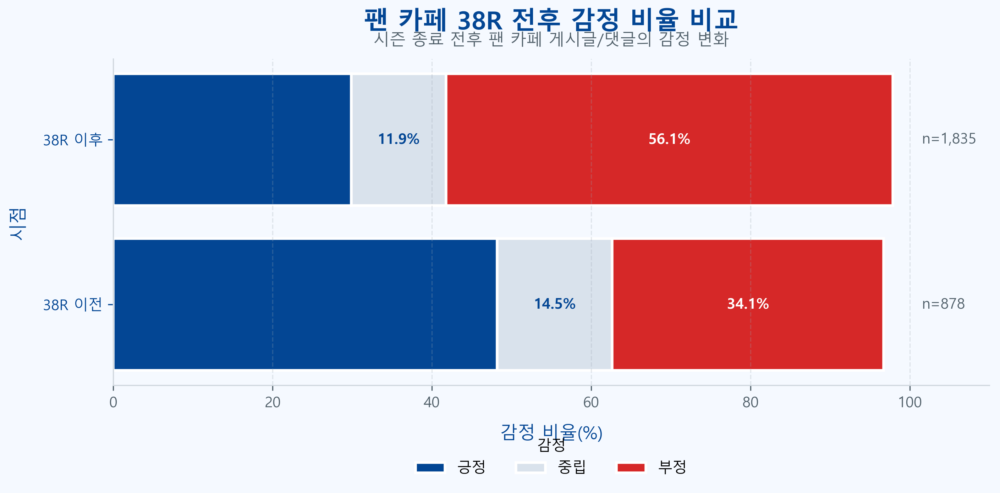
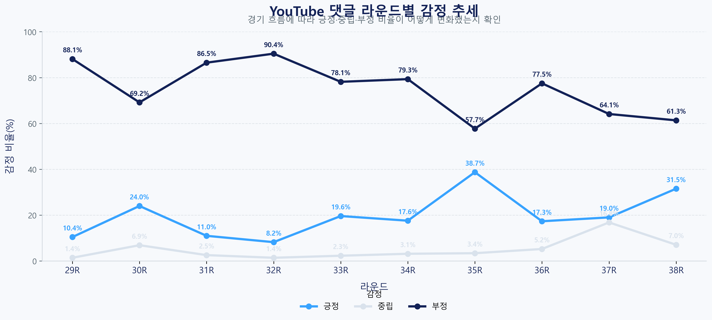

# EPL 5개 구단 팬 반응 텍스트 분석

### YouTube 라운드별 감정과 네이버 팬 카페의 38라운드 전후 반응 비교

텍스트데이터분석 **9조 팀 프로젝트**입니다. 리버풀, 맨체스터 유나이티드, 아스날, 첼시, 토트넘을 대상으로 YouTube 댓글과 네이버 팬 카페 게시글·댓글을 수집했습니다. 감정 라벨로 **반응의 방향**을 비교하고, 단어 빈도와 BERTopic으로 **어떤 이야기가 오갔는지** 살펴봤습니다.

| 최종 데이터 | YouTube 댓글 | 네이버 카페 게시글·댓글 | 분석 구단 |
| ---: | ---: | ---: | ---: |
| **51,219건** | 26,211건 | 25,008건 | 5개 |


## 1. 연구 질문

- **라운드별 변화** · YouTube 경기 관련 영상의 댓글에서 긍정·중립·부정 반응은 라운드에 따라 어떻게 달라졌는가?
- **시즌 마지막 라운드 전후 비교** · 네이버 팬 카페의 감정 구성은 38라운드 전후에 어떻게 바뀌었는가?
- **감정의 맥락** · 카페에서 자주 등장한 단어와 주제는 무엇이며, 경기 전후의 논의는 어떻게 달랐는가?

YouTube는 영상에 매핑된 **경기 라운드**를, 카페는 게시글·댓글의 **작성 시점**을 비교 축으로 사용했습니다. 같은 구단이어도 출처별 이용자와 수집 방식이 달라, 출처를 구분해 결과를 읽었습니다.

## 2. 데이터 범위와 관측 단위

| 구단 | 저장소 ID | YouTube | 네이버 카페 | 합계 | 결과 |
| --- | --- | ---: | ---: | ---: | --- |
| 리버풀 | `liverpool` | 3,732 | 3,929 | 7,661 | [차트](results/liverpool/) |
| 맨체스터 유나이티드 | `manutd` | 3,979 | 9,590 | 13,569 | [차트](results/manutd/) |
| 아스날 | `arsenal` | 5,046 | 6,235 | 11,281 | [차트](results/arsenal/) |
| 첼시 | `chelsea` | 3,533 | 2,713 | 6,246 | [차트](results/chelsea/) |
| 토트넘 | `tottenham` | 9,921 | 2,541 | 12,462 | [차트](results/tottenham/) |
| **합계** | | **26,211** | **25,008** | **51,219** | |

건수는 원본 제출 ZIP의 최종 라벨링 CSV에서 집계한 **텍스트 행 수**입니다. 표본 수에는 감정 처리 결과가 `error`인 319행도 포함됩니다. 한 사람이 여러 글을 쓸 수 있으므로 행 수와 이용자 수는 다릅니다.

| 필드 | 의미 |
| --- | --- |
| `club`, `source`, `content_type` | 구단, 수집 플랫폼, 게시글·댓글 등 텍스트 유형 |
| `round`, `period` | 영상에 연결한 라운드 또는 카페의 38라운드 전후 구분 |
| `text_original`, `text_clean` | 수집 원문과 분석용으로 정리한 텍스트 |
| `content_published_at`, `comment_published_at` | 콘텐츠와 댓글의 작성 시각 |
| `gpt_sentiment`, `gpt_confidence`, `gpt_target`, `gpt_reason` | 감정 라벨, 모델이 부여한 신뢰도, 감정 대상, 판단 근거 |

카페 노트북은 **2026년 5월 25일 00:00**을 전후 구분 기준으로 설정했습니다. `gpt_confidence`는 모델이 생성한 값이며, 별도 검증을 거친 정답 확률로 사용하지 않았습니다.

## 3. 분석 절차

### 3.1 수집과 병합

1. **YouTube** · YouTube Data API를 이용해 선정한 영상의 댓글과 영상 메타데이터를 수집합니다. 영상과 경기 라운드를 연결하고 텍스트를 정리합니다.
2. **네이버 카페** · Selenium으로 게시글과 댓글을 수집합니다. 게시판 접근 권한이 있는 계정으로 수동 로그인한 뒤 진행합니다.
3. **병합** · 구단별로 두 출처를 공통 스키마에 맞춰 합칩니다. 원문과 정제 텍스트를 구분하고, 라운드와 카페 전후 구분을 결과 테이블에 남깁니다.

### 3.2 GPT 감정분석과 2차 라벨링

감정분석 노트북은 `gpt-4.1-mini`를 사용했습니다. 긍정·중립·부정과 함께 감정 대상 및 판단 근거를 기록합니다. 초기 결과에서 중립으로 남은 카페 텍스트 등을 구단별 처리 흐름에 따라 골라 다시 분류한 뒤, 2차 결과를 병합합니다. 일부 흐름은 처리 오류도 재시도합니다.

최종 시각화는 YouTube의 라운드별 감정 건수·비율, 카페의 38라운드 전후 감정 구성, 출처별 감정 구성을 비교합니다. 긍정·부정만 비교하는 차트는 중립까지 포함한 구성비 차트와 분모가 다릅니다.

### 3.3 워드클라우드와 토픽 모델링

- **워드클라우드와 빈도표** · 카페 텍스트를 전후로 나눠 자주 등장한 단어를 비교합니다. 빈도는 어떤 단어가 많이 쓰였는지를 보여주며, 단어만으로 감정 방향을 판단하기는 어렵습니다.
- **BERTopic** · 한국어 문장 임베딩 모델 `jhgan/ko-sroberta-multitask`로 카페 텍스트를 벡터화하고 UMAP·HDBSCAN을 이용해 문서 군집을 구성합니다.
- **상위 주제 정리** · 군집의 주요 단어와 내용을 바탕으로 세부 토픽을 상위 주제로 묶고, 전후 주제 분포를 시각화합니다. 토픽 번호는 구단별 분석 안에서 해석합니다.

## 4. 결과

### 38라운드 전후 카페 감정 구성

아래 표는 최종 CSV에서 `source=cafe`와 해당 전후 기간을 선택해 다시 집계했습니다. **각 구단·기간의 긍정·중립·부정 합계**를 분모로 썼으며, `error`는 제외했습니다.

| 구단 | 유효 건수 전 → 후 | 긍정 비중 전 → 후 | 부정 비중 전 → 후 |
| --- | ---: | ---: | ---: |
| 리버풀 | 1,876 → 2,000 | 36.9% → 41.0% | 46.9% → 41.5% |
| 맨체스터 유나이티드 | 4,160 → 5,269 | 52.5% → 55.4% | 26.7% → 25.2% |
| 아스날 | 2,580 → 3,655 | 53.0% → 53.7% | 18.7% → 17.2% |
| 첼시 | 849 → 1,796 | 49.8% → 30.5% | 35.2% → 57.3% |
| 토트넘 | 673 → 1,856 | 29.4% → 41.4% | 61.1% → 39.3% |

- **첼시**는 카페 부정 비중이 **35.2%에서 57.3%로 상승**했습니다.
- **토트넘**은 부정 건수가 **411건에서 730건으로 늘었지만**, 전체 글도 늘어 부정 비중은 **61.1%에서 39.3%로 하락**했습니다. 반응의 양과 구성이 서로 다른 방향으로 움직인 사례입니다.



### YouTube 라운드별 반응

라운드별 차트는 경기 관련 영상에 달린 댓글을 비교합니다. 영상 수와 댓글 수가 라운드마다 다를 수 있으므로 건수 차트와 비율 차트를 함께 봅니다.



구단별 결과 폴더에는 **라운드별 막대·선 차트, 카페 전후 차트, 출처별 전체 감정 구성, 출처별 긍정·부정 구성**이 들어 있습니다. 워드클라우드와 토픽 모델링은 노트북에서 다시 생성할 수 있습니다.

## 5. 해석 범위

- 수집한 영상과 카페 게시판의 반응을 요약했습니다. 플랫폼별 표본 규모와 글 유형이 달라 전체 팬층의 여론으로 일반화하기 어렵습니다.
- 38라운드 전후 비교에는 경기 외 이슈나 게시량 변화도 섞일 수 있습니다. 차이는 수집 텍스트에서 관측한 변화입니다.
- 감정은 GPT 라벨을 사용했습니다. 반어, 팬덤 은어, 한 글 안의 복합 감정은 분류에 영향을 줄 수 있습니다. 이 결과에는 사람이 작성한 정답셋을 기준으로 측정한 분류 정확도가 포함되어 있지 않습니다.

## 6. 저장소 구성

| 경로 | 내용 |
| --- | --- |
| [notebooks/](notebooks/) | 구단별 수집, 데이터 병합, 라벨링, 워드클라우드, BERTopic 노트북 총 48개 |
| [results/](results/) | 제출본의 구단별 감정분석 PNG 총 25장 |
| [requirements.txt](requirements.txt) | JupyterLab 및 Python 의존성 |

## 7. 재현 방법

### 최종 라벨링 데이터로 시각화

1. 원본 제출 ZIP에서 해당 구단의 `<구단 ID>_youtube_cafe_final_labeled.xlsx`를 꺼내 `notebooks/<구단 ID>/`에 둡니다.
2. 저장소 최상위에서 의존성을 설치하고 JupyterLab을 실행합니다.

   ```sh
   python -m pip install -r requirements.txt
   python -m jupyter lab
   ```

3. 해당 구단 폴더를 작업 디렉터리로 하여 **감정분석 시각화**와 **워드클라우드** 노트북을 실행합니다. 그림을 만들 때 한글 폰트가 필요합니다.
4. 토픽 모델링은 **BERTopic → 상위 토픽 → 시각화** 순서입니다. 임베딩 모델이 로컬에 없다면 첫 로딩에 다운로드가 필요합니다.

### 데이터 수집부터 실행

JupyterLab을 시작하기 전에 환경 변수 `YOUTUBE_API_KEY`와 `OPENAI_API_KEY`를 설정합니다. 카페 수집에는 Chrome과 게시판 열람 권한이 필요합니다. YouTube API에는 할당량이 있고 OpenAI API 호출에는 비용이 발생할 수 있습니다.

| 구단 | 순서와 별도 입력 |
| --- | --- |
| 리버풀·첼시 | 번호가 붙은 (1)~(5)를 차례로 실행합니다. |
| 토트넘 | (1)~(5)를 차례로 실행합니다. 카페 수집에서 `cafe_article_links_filtered.csv`가 필요한 단계가 있습니다. |
| 아스날 | (1) YouTube 추출·라벨링 → (2) 카페 수집·병합·재분석 → (3) 라운드 재매핑 순서입니다. |
| 맨체스터 유나이티드 | (1)~(5) 흐름을 따릅니다. 병합 단계에는 별도로 감정 라벨을 붙인 YouTube 입력이 필요합니다. |

공개용 저장소에는 댓글·게시글 원문, 실행 출력, 발표 PDF·영상을 포함하지 않았습니다. 일부 중간 입력은 원본 제출본과 별도로 준비해야 합니다.
