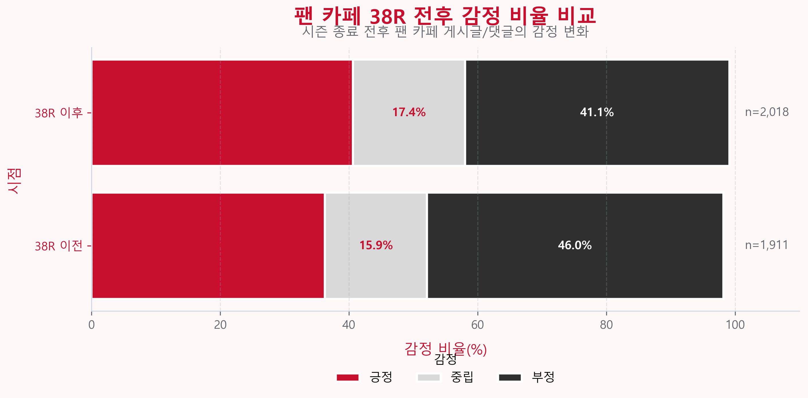

# EPL 5개 구단 팬 반응 텍스트 분석

텍스트데이터분석 9조 팀 프로젝트입니다. YouTube 댓글과 네이버 팬 카페 게시글·댓글을 대상으로, EPL 5개 구단의 팬 반응과 38라운드 전후 카페 여론을 분석했습니다.

- **감정분석** — GPT로 텍스트에 감정 라벨을 부여하고, 중립으로 분류된 카페 데이터를 재분석했습니다. YouTube는 라운드별로, 카페는 38라운드 전후로 집계했습니다.
- **워드클라우드** — 38라운드 전후 카페 텍스트의 주요 단어를 비교했습니다.
- **토픽 모델링** — BERTopic으로 카페 텍스트의 주제를 찾고, 세부 주제를 상위 주제로 묶어 시각화했습니다.

## 결과

건수는 제출본의 최종 라벨링 CSV에서 집계한 행 수입니다.

| 구단 | 분석 레코드 | 결과 |
| --- | ---: | --- |
| 리버풀 | 7,661 | [감정분석 차트](results/liverpool/) |
| 맨유 | 13,569 | [감정분석 차트](results/manutd/) |
| 아스날 | 11,281 | [감정분석 차트](results/arsenal/) |
| 첼시 | 6,246 | [감정분석 차트](results/chelsea/) |
| 토트넘 | 12,462 | [감정분석 차트](results/tottenham/) |



## 저장소 구성

- `notebooks/<구단>/` — 데이터 수집, 병합, 감정분석, 워드클라우드, 토픽 모델링 노트북
- `results/<구단>/` — 제출본에서 가져온 감정분석 집계 차트
- `requirements.txt` — Python 의존성 목록

## 실행 환경

Python 환경을 활성화한 뒤 아래 명령으로 JupyterLab을 실행합니다. 분석용 한글 폰트가 필요하며, 카페 수집에는 Chrome과 해당 게시판을 열람할 수 있는 네이버 계정이 필요합니다. Selenium에서 로그인하는 단계는 수동으로 진행합니다.

```sh
python -m pip install -r requirements.txt
python -m jupyter lab
```

수집과 감정분석을 실행하려면 JupyterLab을 시작하기 전에 터미널 환경 변수에 `YOUTUBE_API_KEY`와 `OPENAI_API_KEY`를 설정합니다. API 호출은 할당량을 사용하며 OpenAI 호출에는 비용이 발생할 수 있습니다.

## 실행 순서

**시각화부터 실행**하려면 원본 제출 ZIP의 구단별 `<구단 ID>_youtube_cafe_final_labeled.xlsx`를 해당 노트북 폴더에 둡니다. 해당 폴더를 작업 디렉터리로 사용해 감정분석 시각화와 워드클라우드를 각각 실행합니다. 토픽 모델링은 BERTopic → 상위 토픽 → 시각화 순서입니다.

**수집부터 실행**하려면 구단별로 번호가 붙은 노트북을 실행합니다. 리버풀·첼시·토트넘은 (1)~(5), 아스날은 (1)~(3) 순서입니다. 맨유 병합 단계는 사전에 감정 라벨을 붙인 YouTube 입력이 필요합니다. 토트넘 카페 수집 단계에서는 `cafe_article_links_filtered.csv` 입력을 확인하세요. 원본 제출물에는 최종 라벨링 파일이 들어 있으며 일부 중간 입력은 별도로 준비해야 합니다.

공개용 패키지에서 게시글·댓글 데이터, 노트북 실행 출력, 발표 PDF와 영상은 제외했습니다. 패키지 검증은 파일 구성과 노트북 정적 검사 범위로 진행했습니다.
